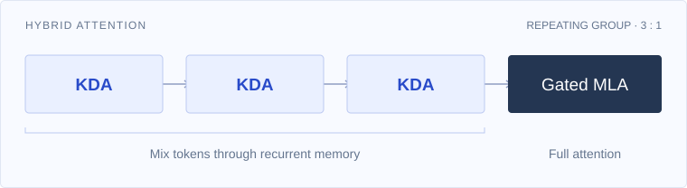
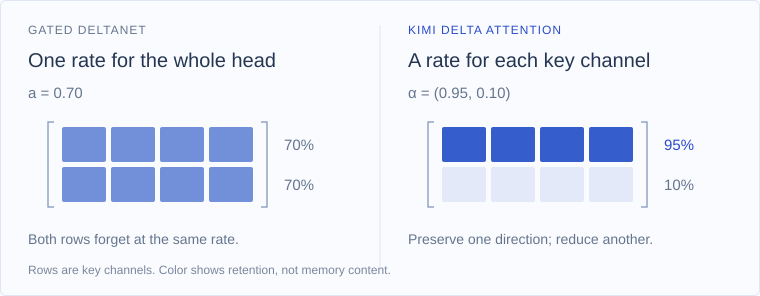
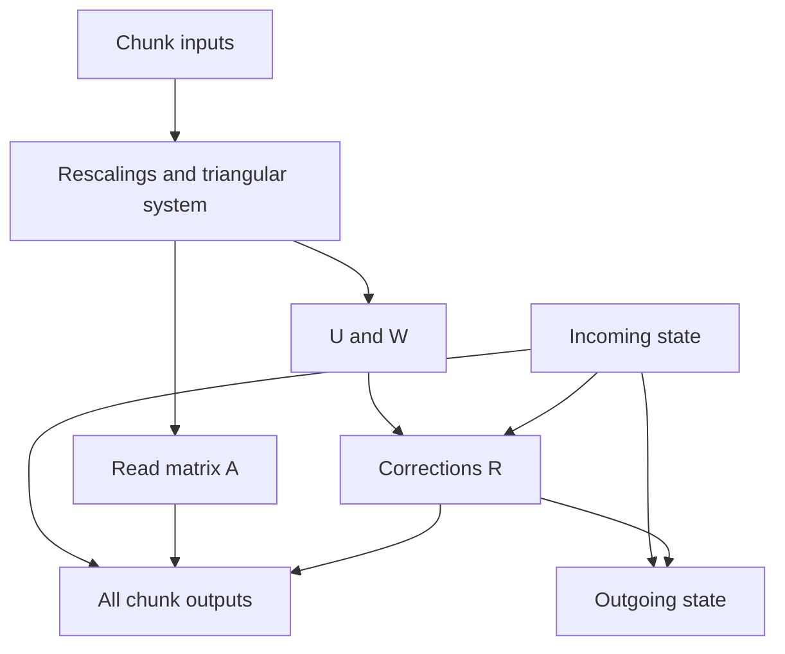

# 01 · Kimi Delta Attention

**First draft · 13 September 2026**

From a fixed-size memory to channel-wise forgetting, recurrent updates, and parallel computation within chunks.

The main sources are **Kimi Linear, arXiv v2**, and **Kimi K3, arXiv v2**. Code blocks below are explanatory pseudocode. The final PyTorch modules and their validation are still pending; review notes at the end identify what remains to be settled.

## 1. Role in Kimi K3

The architecture section of the Kimi K3 report begins its detailed component descriptions with **Hybrid Attention**. Its repeating attention schedule uses three Kimi Delta Attention layers followed by one Gated MLA layer. There is also an additional Gated MLA layer at the end of the backbone. We follow the report's order and begin with KDA. [K3, §2.1, p. 4](https://arxiv.org/pdf/2607.24653v2#page=4)

<picture>
  <source media="(max-width: 520px)" srcset="../assets/kda/hybrid-attention-mobile.svg">
  
</picture>

*Attention modules only. The report also adds a Gated MLA layer at the end of the backbone.*

KDA occupies the token-mixing part of a layer: it lets the representation at one position depend on information from preceding positions. In the architecture diagram, each attention layer is followed by a Stable LatentMoE layer. We will study the surrounding residual connections and expert computation in later chapters. [K3, §2 and Fig. 2, p. 3](https://arxiv.org/pdf/2607.24653v2#page=3)

For KDA, that access to the past takes place through a matrix-valued memory. Each token modifies the memory and reads from it. The size of this state stays fixed as the sequence grows. This gives us a useful starting question: **how should a fixed-size memory decide what to retain and what to update?**

KDA was introduced in **Kimi Linear**, before K3. We therefore turn to that paper to understand the mechanism, then return to K3's decay and output-gate changes in Section 6. [Kimi Linear, §3](https://arxiv.org/html/2510.26692v2#S3)

## 2. Minimal background

### 2.1. Linear attention: collect information before reading it

In causal softmax attention, a query is compared against the keys of all available tokens. Linear attention changes the similarity function so that it can be written using feature maps, $\phi(q)^\top\phi(k)$. Associativity then lets us collect key–value information before applying a query. This is the connection developed by Katharopoulos et al. [2020, §§3.2–3.4, Eqs. (9)–(12)](https://proceedings.mlr.press/v119/katharopoulos20a/katharopoulos20a.pdf#page=4)

To see the idea, consider the numerator of the attention output:

$$
\sum_{i=1}^{t}\bigl(\phi(k_i)^\top\phi(q_t)\bigr)v_i
=
\left(\sum_{i=1}^{t}\phi(k_i)v_i^\top\right)^\top\phi(q_t).
$$

The matrix inside the parentheses contains everything this expression needs from the past. Adding a token adds one outer product. We can maintain that matrix incrementally, instead of recomputing the sum at every position.

For the background that follows, absorb the feature map into the names $q$ and $k$, and write the **unnormalized** memory rule:

$$
S_t=S_{t-1}+k_tv_t^\top,
\qquad
\widetilde o_t=S_t^\top q_t.
$$

This is a deliberate simplification. Katharopoulos et al.'s normalized attention also maintains a sum of feature-mapped keys for the denominator. KDA does not inherit that denominator, nor does it simply reproduce softmax attention through a change in evaluation order.

### 2.2. Fast weights and the delta rule: update an association

Schlag, Irie, and Schmidhuber connect linear attention to **fast weight programming**: the memory can be viewed as the weights of a linear map, updated as the sequence is processed. They also introduce an error-correcting update in place of unconditional accumulation. [2021, §§3–4, especially §4.2, Eqs. (20)–(25)](https://proceedings.mlr.press/v139/schlag21a/schlag21a.pdf#page=4)

The question before writing is now: *what value does the memory already associate with this key?*

$$
\widehat v_t=S_{t-1}^\top k_t,
\qquad
S_t=S_{t-1}+\beta_t k_t(v_t-\widehat v_t)^\top.
$$

The vector $v_t-\widehat v_t$ is the prediction error. The scalar $\beta_t$ controls how strongly to correct it. Here, "fast weights" describes the sequence-dependent state; the model's learned projection matrices are separate parameters.

An outer product writes along a key direction. Consequently, correcting one association can also affect another whose key overlaps with that direction. Finite memory still requires choices about what to retain. This viewpoint will matter when we discuss forgetting.

We use $S\in\mathbb R^{d_k\times d_v}$ throughout. Some preceding papers use its transpose, so their updates place the key on the right. The two conventions describe the same operation.

### 2.3. Mamba-2 and Gated DeltaNet: give the memory a lifetime

The simplified memory view of Mamba-2 introduces input-dependent decay:

$$
S_t=a_tS_{t-1}+k_tv_t^\top.
$$

Here $a_t$ changes with the input, allowing the model to reduce the influence of earlier information. This equation suppresses Mamba-2's specific parameterization; it is the comparison used in Gated DeltaNet's background. For the underlying state-space duality, see Dao and Gu's Mamba-2 paper. [GDN, §2.1](https://arxiv.org/pdf/2412.06464v3#page=2); [Dao and Gu, 2024](https://proceedings.mlr.press/v235/dao24a.html)

Gated DeltaNet combines this decay with the delta rule. In our state orientation:

$$
S_t=(I-\beta_tk_tk_t^\top)(a_tS_{t-1})
    +\beta_tk_tv_t^\top.
$$

Its two controls have different jobs. Decay reduces old content; the delta correction adjusts the association addressed by the current key. This combination is the immediate predecessor of KDA. [Yang, Kautz, and Hatamizadeh, §3.1, Eq. (10)](https://arxiv.org/pdf/2412.06464v3#page=4)

However, $a_t$ is a **single scalar per head**. At the decay step, every entry in that head's state is multiplied by the same number. The delta update is already selective through the key, but the additional forgetting mechanism cannot retain different key channels at different rates. That is the specific restriction KDA changes.

## 3. The contribution: forgetting by key channel

### 3.1. Replace a scalar with a vector

KDA replaces $a_t$ with a vector $\alpha_t\in(0,1)^{d_k}$ and applies it through a diagonal matrix. Its recurrent equation is:

$$
\boxed{
S_t=(I-\beta_tk_tk_t^\top)\operatorname{Diag}(\alpha_t)S_{t-1}
    +\beta_tk_tv_t^\top,
\qquad
\widetilde o_t=S_t^\top q_t.
}
$$

This is [Kimi Linear, §3, Eq. (1)](https://arxiv.org/html/2510.26692v2#S3), also used in [K3, §2.1.1, Eq. (1)](https://arxiv.org/pdf/2607.24653v2#page=4). We write $\widetilde o_t$ for the core output to distinguish it from the complete layer output later.

For one head and one token, the objects are:

| Symbol | Shape | Meaning |
|---|---|---|
| $q_t,k_t$ | $d_k$ | Query for reading; key addressing the update |
| $v_t$ | $d_v$ | Target value for the current association |
| $S_{t-1}$ | $d_k\times d_v$ | Memory before processing this token |
| $\alpha_t$ | $d_k$ | Retention factor for each key channel |
| $\beta_t$ | Scalar | Strength of the delta correction |
| $\widetilde o_t$ | $d_v$ | Result of reading the updated memory |

Multiplication by $\operatorname{Diag}(\alpha_t)$ scales the **rows** of our state matrix:

$$
\bigl[\operatorname{Diag}(\alpha_t)S_{t-1}\bigr]_{j,:}
=\alpha_{t,j}S_{t-1}[j,:].
$$

Each row belongs to a coordinate of the learned key space. A row is not a storage slot dedicated to one past token. Channel-wise forgetting offers finer control over a compressed representation; it does not give the layer an independently adjustable forget gate for every historical token.

For example, $\alpha_t=(0.95,0.10)$ can preserve most of the first row while strongly reducing the second. A scalar gate cannot express those two rates in the same head. If all coordinates of $\alpha_t$ equal $a_t$, the equation reduces to Gated DeltaNet.

<picture>
  <source media="(max-width: 520px)" srcset="../assets/kda/channelwise-decay-mobile.svg">
  
</picture>

*The decay step, isolated from the delta correction. Each row is a coordinate of the key space, not a separate past token.*

### 3.2. Read the equation in execution order

Introduce the retained state:

$$
\overline S_t=\operatorname{Diag}(\alpha_t)S_{t-1}.
$$

This is the memory that remains after forgetting. Now use the current key to read its prediction:

$$
\widehat v_t=\overline S_t^\top k_t.
$$

Subtract that prediction from the target value:

$$
e_t=v_t-\widehat v_t.
$$

Finally, write the correction and read the new state with the query:

$$
S_t=\overline S_t+\beta_tk_te_t^\top,
\qquad
\widetilde o_t=S_t^\top q_t.
$$

Expanding $e_t$ recovers the boxed recurrence. This decomposition is our direct algebraic interpretation of Eq. (1): **retain, predict, correct, read**.

The order matters. The prediction uses $\overline S_t$, after decay. Computing it from $S_{t-1}$ and then decaying the state implements a different recurrence. Likewise, the output reads $S_t$, after the current update; this will determine the diagonal of the causal mask in the chunkwise formula.

The matrix correction has shape $d_k\times d_v$. Its rank is at most one because it is an outer product. We need neither an explicitly constructed $d_k\times d_k$ identity nor a materialized diagonal matrix to perform these operations.

### 3.3. What the write strength actually controls

For a unit-norm key, read the updated state at the same key:

$$
S_t^\top k_t
=\widehat v_t+\beta_te_t\underbrace{(k_t^\top k_t)}_{1}
=(1-\beta_t)\widehat v_t+\beta_tv_t.
$$

This gives a precise interpretation of $\beta_t$: it interpolates between the retained prediction and the target. In the limiting case $\beta_t=1$, the new read at that key equals $v_t$. At $\beta_t=0$, only decay remains. These endpoint cases help interpret the rule, even though a sigmoid with finite logits produces values strictly between them.

At another query $q$, the correction contributes $\beta_t e_t(k_t^\top q)$. It therefore affects overlapping directions too. The mechanism makes a targeted linear correction, with the selectivity determined by key–query geometry.

### 3.4. One numerical update

Take a deliberately small state and a normalized key:

$$
S_{t-1}=\begin{bmatrix}10&0\\0&10\end{bmatrix},
\quad\alpha_t=\begin{bmatrix}0.9\\0.2\end{bmatrix},
\quad k_t=q_t=\begin{bmatrix}1\\0\end{bmatrix},
\quad v_t=\begin{bmatrix}6\\4\end{bmatrix},
\quad\beta_t=0.5.
$$

| Operation | Result | Interpretation |
|---|---|---|
| Retain | $\overline S_t=\begin{bmatrix}9&0\\0&2\end{bmatrix}$ | The two key channels decay at different rates. |
| Predict | $\widehat v_t=(9,0)^\top$ | The current key reads the first row. |
| Compute error | $e_t=(-3,4)^\top$ | This is the difference between target and prediction. |
| Correct | $S_t=\begin{bmatrix}7.5&2\\0&2\end{bmatrix}$ | Half of the error is written along the key direction. |
| Read | $\widetilde o_t=(7.5,2)^\top$ | The query reads the updated association. |

The second row experiences forgetting but no delta correction in this example, because the second coordinate of the key is zero. This separates the effects of $\alpha_t$ and $\beta_t$ concretely.

## 4. From the recurrence to computation

### 4.1. A direct recurrent core

Once $q,k,v,\alpha,\beta$ are available, the recurrent algorithm is short:

```python
# One head. state: [d_k, d_v]
# q[t], k[t], alpha[t]: [d_k]; v[t]: [d_v]; beta[t]: scalar
outputs = []

for t in range(sequence_length):
    retained = alpha[t][:, None] * state
    prediction = retained.T @ k[t]
    error = v[t] - prediction
    state = retained + beta[t] * outer(k[t], error)
    outputs.append(state.T @ q[t])

return stack(outputs), state
```

Each line corresponds to an operation in Section 3.2. For batching, we add independent batch and head dimensions; the memory becomes $[B,H,d_k,d_v]$.

During decoding, one new token performs one update. The memory stores $d_kd_v$ numbers per head, independent of the number of past tokens. With dimensions fixed, processing $T$ tokens requires work proportional to $T$. This statement concerns the recurrent core; training activations and the rest of the hybrid model have their own memory requirements.

### 4.2. Where the inputs to the recurrence come from

A complete KDA layer must produce those vectors and gates from its input representation $x_t\in\mathbb R^d$. Kimi Linear uses the following per-head construction, also shown in K3. [Kimi Linear, §4, pp. 5–6](https://arxiv.org/pdf/2510.26692v2#page=5); [K3, Eq. (2)](https://arxiv.org/pdf/2607.24653v2#page=4)

$$
\begin{aligned}
q_t^h&=\operatorname{L2Norm}\!\left(\operatorname{Swish}\!\left(\operatorname{ShortConv}_q(W_q^hx)_t\right)\right),\\
k_t^h&=\operatorname{L2Norm}\!\left(\operatorname{Swish}\!\left(\operatorname{ShortConv}_k(W_k^hx)_t\right)\right),\\
v_t^h&=\operatorname{Swish}\!\left(\operatorname{ShortConv}_v(W_v^hx)_t\right),\\
\beta_t^h&=\sigma(W_\beta^hx_t).
\end{aligned}
$$

The subscript $t$ after ShortConv emphasizes that convolution acts over a short causal history of projected inputs. It is not a function of an isolated token alone. Swish, also called SiLU, applies $u\sigma(u)$ elementwise. L2 normalization fixes the length of each query and key; values are not normalized by this step.

For a nonzero key, unit normalization makes the eigenvalue of $I-\beta kk^\top$ along $k$ equal to $1-\beta$; orthogonal directions have eigenvalue one. It also gives the interpolation identity derived above. Query normalization controls the scale of the read. The eventual implementation must specify its treatment of near-zero norms.

The decay logits come from a low-rank projection. Using K3's explicit bias notation and showing the head slice:

$$
z_t^h=[W_\alpha^\uparrow W_\alpha^\downarrow x_t]_h+b_\alpha^h.
$$

"Low rank" means that a smaller intermediate vector connects the down- and up-projections. It does not make the decay scalar: the resulting logits still have one coordinate per key channel. The mapping from $z_t^h$ to $\alpha_t^h$ is where K3 will make its first change.

For now, it is enough to know Kimi Linear's mapping:

$$
g_t^h=-\exp(A_h)\operatorname{softplus}(z_t^h),
\qquad \alpha_t^h=\exp(g_t^h).
$$

Here $g_t^h$ is a **log-retention** vector and $A_h$ is a learned scalar per head. Negative $g$ produces retention between zero and one; more negative entries forget more strongly. K3 explicitly contrasts this mapping with its replacement in Fig. 3. [K3, §2.1.1, p. 5](https://arxiv.org/pdf/2607.24653v2#page=5)

After the recurrent core, Kimi Linear applies head-wise RMSNorm, an input-dependent sigmoid output gate, and an output projection:

$$
y_t=W_o\left[
\sigma(W_g^\uparrow W_g^\downarrow x_t)
\odot\operatorname{RMSNorm}_{\rm head}(\widetilde o_t)
\right].
$$

Here $\widetilde o_t$ collects the head outputs, normalization is applied within each head, and the gated heads are concatenated for $W_o$. This gate controls what leaves the attention module. The retention gate $\alpha$ controls what remains in its memory. [Kimi Linear, §4, Eq. (10)](https://arxiv.org/pdf/2510.26692v2#page=6)

The recurrent core is now understandable on its own. We will implement the complete layer after incorporating K3's changes, using this pseudocode as the mathematical reference.

## 5. Efficient execution: parallel work within a chunk

### 5.1. The problem with processing one token at a time

The recurrent algorithm is a natural match for decoding: only one new token is available at each step. In training and prompt prefill, however, many positions are available together. A literal token loop repeatedly performs small operations while each new state waits for its predecessor.

For plain unnormalized linear attention with zero initial state, the same outputs can instead be written as

$$
O=\operatorname{Tril}(QK^\top)V.
$$

Here rows are positions, and $\operatorname{Tril}$ retains entries on and below the diagonal. This parallel form computes interactions through matrix multiplication, but materializing its attention matrix costs $T\times T$ entries. The recurrent and parallel forms therefore expose different computational trade-offs. [Yang et al., DeltaNet, §2.1](https://arxiv.org/pdf/2406.06484v6#page=2)

KDA needs an additional step: its writes depend on the current memory prediction, so inserting the original values into this plain-attention expression would lose the delta rule. We must account for those dependent corrections.

The chunkwise approach does this for a short group of $C$ tokens at a time. Local interactions become $C\times C$ matrices; a $d_k\times d_v$ state carries information between chunks. The DeltaNet parallelization paper by Songlin Yang and colleagues develops this approach for delta updates, GDN adds scalar decay, and Kimi Linear handles channel-wise decay. [DeltaNet, §3](https://arxiv.org/pdf/2406.06484v6#page=4); [GDN, §3.3](https://arxiv.org/pdf/2412.06464v3#page=6); [Kimi Linear, §3.1](https://arxiv.org/html/2510.26692v2#S3.SS1)

### 5.2. Separate the incoming memory from local writes

Consider one chunk. Re-index its tokens as $i=1,\ldots,C$, and call its incoming state $S_{\rm in}$. All vectors below belong to this chunk. Define cumulative retention from the start of the chunk:

$$
\gamma_i=\prod_{r=1}^{i}\alpha_r,
\qquad \gamma_0=\mathbf 1.
$$

Products and divisions of decay vectors are elementwise. A write made at position $j$ subsequently experiences

$$
\frac{\gamma_i}{\gamma_j}
=\prod_{r=j+1}^{i}\alpha_r
\qquad (j\le i).
$$

The product starts at $j+1$: the write occurs **after** position $j$ has decayed the preceding state. For $i=j$, the ratio is one.

Now name the actual vector written at each position:

$$
r_i=\beta_i\left(v_i-\overline S_i^\top k_i\right).
$$

The recurrent update becomes $S_i=\operatorname{Diag}(\alpha_i)S_{i-1}+k_ir_i^\top$. Expanding this expression gives

$$
S_i=
\operatorname{Diag}(\gamma_i)S_{\rm in}
+\sum_{j=1}^{i}
\operatorname{Diag}\!\left(\frac{\gamma_i}{\gamma_j}\right)k_jr_j^\top.
$$

This is an identity, but it is not yet a parallel algorithm: we have merely hidden the state dependence inside $r_j$. Its value is that it separates the surviving incoming memory from the writes made in this chunk. The next step removes the need to discover those writes by advancing every token state.

### 5.3. Turn the dependent corrections into a small linear system

Substitute the expanded memory into the definition of $r_i$:

$$
r_i=\beta_i\left[
v_i-S_{\rm in}^\top(\gamma_i\odot k_i)
-\sum_{j<i}
\underbrace{k_i^\top
\operatorname{Diag}\!\left(\frac{\gamma_i}{\gamma_j}\right)k_j}_{\text{effect of write }j\text{ on prediction }i}
r_j
\right].
$$

Every coefficient of an earlier correction depends only on keys, retention, and write strengths. We can construct these coefficients before knowing the incoming state.

Stack the chunk vectors as rows. Let $\Gamma$ contain the rows $\gamma_i^\top$, and define

$$
K^+=\Gamma\odot K,
\qquad K^-=K/\Gamma,
\qquad Q^+=\Gamma\odot Q,
\qquad D_\beta=\operatorname{Diag}(\beta_1,\ldots,\beta_C).
$$

The superscripts $+$ and $-$ name two rescalings of the same keys. In particular,

$$
[K^+(K^-)^\top]_{ij}
=k_i^\top\operatorname{Diag}\!\left(\frac{\gamma_i}{\gamma_j}\right)k_j.
$$

Only $j<i$ contributes to the prediction before the current write. Define

$$
L=\operatorname{StrictTril}\!\left(D_\beta K^+(K^-)^\top\right),
$$

where $\operatorname{StrictTril}$ retains entries strictly below the diagonal. Stacking the $r_i^\top$ into $R$ gives

$$
(I+L)R=D_\beta(V-K^+S_{\rm in}).
$$

The identity matrix contributes ones on the diagonal, so $I+L$ is a unit lower-triangular matrix. It is invertible in exact arithmetic. This packages the dependent corrections into a triangular system instead of a loop over full memory states.

To match the paper's final notation, define

$$
M=(I+L)^{-1}D_\beta,
\qquad U=MV,
\qquad W=MK^+.
$$

Then

$$
\boxed{R=U-WS_{\rm in}.}
$$

$U$ is the transformed value term; $W$ describes how the incoming memory changes the corrections. Both can be computed from the chunk's inputs without $S_{\rm in}$. They are computed tensors, not learned projection matrices. The expression $U-WS_{\rm in}$ is the paper's pseudo-value term. These definitions recover [Kimi Linear, Eqs. (6)–(7)](https://arxiv.org/pdf/2510.26692v2#page=4).

This derivation gives us the role of the auxiliary matrices without developing the full WY representation or UT transformation. Those techniques organize products of structured updates for efficient computation. Their derivations are available in [Kimi Linear, §3.1 and Appendix B](https://arxiv.org/html/2510.26692v2), and [Yang et al., DeltaNet, Appendix B.1–B.2](https://arxiv.org/pdf/2406.06484v6).

### 5.4. Compute all outputs in the chunk

Read the expanded state with each query and stack the results:

$$
A=\operatorname{Tril}\!\left(Q^+(K^-)^\top\right),
$$

$$
\boxed{
O=
\underbrace{Q^+S_{\rm in}}_{\text{incoming memory}}
+\underbrace{A\left(U-WS_{\rm in}\right)}_{\text{writes inside this chunk}}.
}
$$

This is [Kimi Linear, Eq. (9)](https://arxiv.org/pdf/2510.26692v2#page=5), also given in [K3, Eq. (4)](https://arxiv.org/pdf/2607.24653v2#page=4).

The first term reads the incoming memory after the appropriate cumulative retention at each position. The second combines local corrections with their query–key interactions and subsequent decay. The output mask includes its diagonal because the current query reads the state after its own update. Unlike softmax probabilities, the entries of $A$ need not be positive or sum to one.

No individual state $S_1,\ldots,S_C$ appears in this output expression. Once the chunk's incoming state and local matrices are available, all of its output rows can be computed using matrix operations. The triangular solve still has a dependency structure; writing an inverse does not make all work independent. The gain is in reorganizing that work and avoiding a sequence of full-state updates inside the chunk.

### 5.5. Pass the final state to the next chunk

We also need the memory after the last position. Define a matrix of keys rescaled to the end of the chunk:

$$
K^{\rm end}[j,:]
=\left(\frac{\gamma_C}{\gamma_j}\odot k_j\right)^\top.
$$

Then the state expansion at $i=C$ gives

$$
\boxed{
S_{\rm out}=
\operatorname{Diag}(\gamma_C)S_{\rm in}
+(K^{\rm end})^\top\left(U-WS_{\rm in}\right).
}
$$

The next chunk receives $S_{\rm out}$ as its incoming state. Thus the straightforward schedule remains recurrent **between chunks**, while the token-level work within each chunk is reorganized into matrix operations.

The shapes provide a compact check on the construction:

| Quantity | Shape | Role |
|---|---|---|
| $Q,K,\Gamma,K^+,K^-,Q^+,K^{\rm end}$ | $C\times d_k$ | Queries, keys, and channel-wise rescalings |
| $V,U,R,O$ | $C\times d_v$ | Values, corrections, and outputs |
| $L,M,A$ | $C\times C$ | Local update and read interactions |
| $W$ | $C\times d_k$ | Incoming-memory correction coefficients |
| $S_{\rm in},S_{\rm out}$ | $d_k\times d_v$ | Memory at chunk boundaries |

> **Source-notation review.** Kimi Linear Eq. (8) writes the outgoing-state factor using $\Gamma^{i\rightarrow C}$. With the inclusive decay definition in §2.1, that notation needs care. Here we explicitly use $\gamma_C/\gamma_i=\prod_{r=i+1}^{C}\alpha_r$, derived from Eq. (1). In particular, the final token's new write is not decayed again. The compact superscripts in Eqs. (3)–(5) and (8) remain a source-audit item before implementation; our boundary convention is explicit throughout.

### 5.6. A computation sketch

The following pseudocode exposes the matrix operations. `solve_lower(L, B)` means solving the lower-triangular system $LX=B$, not explicitly constructing an inverse.

```python
# One head, one chunk; explanatory mathematics, not a stable kernel.
# Q, K, alpha: [C, d_k]; V: [C, d_v]; beta: [C]
# incoming: [d_k, d_v]
gamma = cumulative_product(alpha, axis=0)
K_plus = gamma * K
K_minus = K / gamma
Q_plus = gamma * Q

system = eye(C) + strict_lower(beta[:, None] * (K_plus @ K_minus.T))
U = solve_lower(system, beta[:, None] * V)
W = solve_lower(system, beta[:, None] * K_plus)
corrections = U - W @ incoming

read_weights = lower_including_diagonal(Q_plus @ K_minus.T)
outputs = Q_plus @ incoming + read_weights @ corrections

K_end = (gamma[-1] / gamma) * K
outgoing = gamma[-1][:, None] * incoming + K_end.T @ corrections
return outputs, outgoing
```

The dependency structure is:



The diagram highlights dependencies on the incoming state; rescaled queries and end-of-chunk keys are also used in the two final expressions above.

With a fixed chunk size, local attention-shaped matrices grow in total as approximately $(T/C)C^2=TC$, rather than $T^2$. Chunkwise computation creates opportunities for efficient matrix multiplication, but its speed depends on the implementation and hardware. A readable PyTorch version will establish equivalence; it will not by itself reproduce the performance of the paper's kernels.

There is also a numerical issue in the sketch: cumulative retention can become tiny, making $K/\Gamma$ enormous. We now return to K3, because its first modification directly addresses this issue.

## 6. Back to Kimi K3

K3 keeps the recurrent mechanism and the chunkwise output formula we have just studied. Its two explicit changes within the KDA description concern **the decay mapping** and **the output gate**. [K3, §2.1.1, pp. 4–5](https://arxiv.org/pdf/2607.24653v2#page=4)

### 6.1. Bound the log-decay

Recall Kimi Linear's mapping:

$$
g_t^h=-\exp(A_h)\operatorname{softplus}(z_t^h),
\qquad \alpha_t^h=\exp(g_t^h).
$$

Its log-retention is negative and unbounded below. K3 replaces it with

$$
\boxed{
g_t^h=g_{\min}\,\sigma\!\left(\exp(A_h)z_t^h\right),
\qquad
\alpha_t^h=\exp(g_t^h),
\qquad g_{\min}=-5.
}
$$

The report defines $A_h$ as a learned per-head log-scale, initialized to zero. [K3, Eq. (5) and Fig. 3, p. 5](https://arxiv.org/pdf/2607.24653v2#page=5)

The sigmoid lies between zero and one. Multiplying it by $-5$ puts each component of $g_t^h$ between $-5$ and zero, and exponentiation puts retention between $e^{-5}$ and one. The factor $\exp(A_h)$ is **inside** the sigmoid; multiplying its output by that factor would change the bound.

This matters computationally because cumulative products become sums in log space:

$$
\log\gamma_{i,j}=\sum_{r=1}^{i}g_{r,j}.
$$

Within a 16-token tile, the sum is greater than $-80$. Its inverse rescaling is therefore less than $e^{80}$, which fits within the BF16 exponent range. K3 uses this bounded range to replace the remaining position-pair computation on diagonal tiles with dense matrix multiplication. [K3, §2.1.1, "Lower-bounded decay" and Fig. 3](https://arxiv.org/pdf/2607.24653v2#page=5)

The bound concerns those local tiles. It does not make an arbitrary-length product safe: extending the same argument to 128 steps gives a possible log-retention near $-640$. The chunkwise pseudocode above still needs a deliberate numerical strategy for large chunks and low precision. Fitting a reciprocal in the exponent range also does not guarantee that every subsequent arithmetic operation is accurate or finite.

The mathematical effect is equally clear. A single decay step cannot drive a channel's retention below $e^{-5}\approx0.0067$, although repeated decay can still make old information negligible. The change therefore constrains the recurrence's parameterization as well as helping its evaluation.

```python
# Elementwise within each head; A[h] is a scalar.
z = up_alpha(down_alpha(x)) + alpha_bias
log_alpha = -5.0 * sigmoid(exp(A) * z)
alpha = exp(log_alpha)
```

### 6.2. Use a full-rank output gate

Kimi Linear computes its output-gate logits through two low-rank factors. K3 uses a direct learned projection:

$$
\boxed{
y_t=W_o\left[
\sigma(W_gx_t)\odot
\operatorname{RMSNorm}_{\rm head}(\widetilde o_t)
\right].
}
$$

The normalization and sigmoid gating remain; the factorization of the gate projection changes. [Kimi Linear, Eq. (10)](https://arxiv.org/pdf/2510.26692v2#page=6); [K3, Eq. (6)](https://arxiv.org/pdf/2607.24653v2#page=5)

If the concatenated head outputs have width $m=Hd_v$, then $W_g$ maps $\mathbb R^d$ to $\mathbb R^m$. A factorization through width $r$ restricts the effective linear map to rank at most $r$. A direct projection removes that structural restriction. "Full rank" here describes the parameterization; it does not guarantee that the learned matrix attains its maximum possible rank.

The gate acts on the normalized readout, so it does not alter the state-transition algebra derived in Section 5. Both recurrent and chunkwise cores can feed the same K3 output path:

```python
# core_output: [batch, time, heads, d_v]
normalized = rmsnorm_per_head(core_output)
gate = sigmoid(output_gate_projection(x))
y = output_projection(gate * concatenate_heads(normalized))
```

The distinction between the two versions can now be recorded precisely:

| Part | Kimi Linear | Kimi K3 |
|---|---|---|
| State update | Channel-wise decay followed by delta correction | Same recurrence |
| Write strength | Per-head sigmoid $\beta$ | Same form |
| Decay logits | Low-rank projection | Low-rank projection, with explicit per-head bias in Eq. (2) |
| Log-decay mapping | $-e^{A_h}\operatorname{softplus}(z)$ | $-5\sigma(e^{A_h}z)$ |
| Output-gate logits | $W_g^\uparrow W_g^\downarrow x$ | $W_gx$ |
| Core evaluation | Recurrent or chunkwise | Recurrent or chunkwise; bounded decay enables the reported tile computation change |

This comparison follows the two papers' mathematical descriptions. Checkpoint-specific dimensions, initialization details, and implementation conventions will be pinned when we build the modules.

## 7. PyTorch implementation and verification

### 7.1. Two implementations of the K3 layer

The repository will contain two explicit modules implementing the complete K3 KDA layer:

| Planned file | Responsibility | Current status |
|---|---|---|
| `src/kimi_k3/attention/kda_recurrent.py` | Prepare projections and gates, evaluate the recurrence, normalize and gate the output | Pending |
| `src/kimi_k3/attention/kda_chunkwise.py` | Use the same parameterization and evaluate the core through chunks | Pending |

The modules should accept the same learned weights. The recurrent implementation will provide the direct reference; the chunkwise implementation will expose how the same computation is reorganized. We will use code excerpts here once these files exist.

> **Implementation placeholder.** Add the actual recurrent and chunkwise excerpts, links to their canonical files, and a compact account of deliberate differences from the official implementation. No separate maintained Kimi Linear layer is planned: the earlier version supplies the explanation, and both final modules will target K3.

### 7.2. What must agree

With identical weights and initial states, both paths must agree on outputs and outgoing recurrent states within justified numerical tolerances. Training equivalence additionally requires agreement of gradients with respect to inputs and learned parameters.

The verification should make several failure modes visible:

- **State continuity:** a full sequence agrees with segmented execution and prefill followed by decoding, including the short-convolution histories.
- **Causality:** changing later inputs does not alter earlier outputs.
- **Chunk boundaries:** a chunk of length one recovers the recurrent step; multiple chunks and a final partial chunk preserve the same computation, including a nonzero incoming state.
- **Limiting cases:** uniform channel retention recovers the scalar GDN rule; disabled updates leave only decay. These are tests of the mathematical core, with gates supplied directly.
- **Numerical behavior:** chosen precision and chunk sizes handle the intended decay ranges without relying on unsafe raw reciprocals.

> **Verification placeholder.** Add test links and measured tolerances after implementation. During preparation of this draft, an independent float64 algebra check compared the displayed recurrent and chunkwise core equations on short random examples, including unequal key/value dimensions and nonzero incoming states. Their outputs and final states agreed to floating-point roundoff. This is a check on the formulas, not validation of a complete KDA module or its gradients.

### 7.3. Review notes for this draft

The mathematical account is ready for editorial review. The remaining work is explicit:

| Item | What still needs to be resolved |
|---|---|
| Source indexing | Complete the audit of Kimi Linear's cumulative-decay superscripts discussed in Section 5.5; preserve the explicit boundary convention used here. |
| K3 configuration | Pin the official artifact revision and record projection widths, ShortConv details, normalization conventions, and initialization. |
| Implementations | Replace pseudocode placeholders with excerpts from the two final K3 modules. |
| Numerical execution | Specify how the readable chunkwise implementation evaluates relative decay safely and how it differs from tiled production kernels. |
| Verification | Add actual output, state, gradient, causality, and streaming results once the modules exist. |

## 8. References

Section and equation references in the text refer to the editions listed below. Equations expanded for explanation, the numerical example, the dependency diagram, and pseudocode are our own mathematical presentation. Source-specific architecture choices are attributed locally.

| Source | Edition used | Contribution to this chapter |
|---|---|---|
| Kimi Team. **Kimi K3: Open Frontier Intelligence.** | [arXiv:2607.24653v2](https://arxiv.org/abs/2607.24653v2), 7 August 2026 | §2 and Fig. 2 locate KDA; §2.1 gives the hybrid schedule; §2.1.1, Eqs. (1)–(6), gives the recurrence, parameterization, chunkwise readout, bounded decay, and full-rank output gate. |
| Kimi Team. **Kimi Linear: An Expressive, Efficient Attention Architecture.** | [arXiv:2510.26692v2](https://arxiv.org/abs/2510.26692v2), 1 November 2025 | §2 provides the immediate background; §3, Eq. (1), defines KDA; §3.1, Eqs. (6)–(9), gives the chunkwise matrices; §4 describes the surrounding layer and Eq. (10) its output gate. |
| Angelos Katharopoulos, Apoorv Vyas, Nikolaos Pappas, François Fleuret. **Transformers are RNNs: Fast Autoregressive Transformers with Linear Attention.** | [ICML 2020, PMLR 119](https://proceedings.mlr.press/v119/katharopoulos20a.html) | §§3.2–3.4 connect feature-mapped attention, causal accumulation, and recurrent execution. Eqs. (9)–(12) retain the normalization omitted from our simplified background rule. |
| Imanol Schlag, Kazuki Irie, Jürgen Schmidhuber. **Linear Transformers Are Secretly Fast Weight Programmers.** | [ICML 2021, PMLR 139](https://proceedings.mlr.press/v139/schlag21a.html) | §§3–4 give the fast-weight interpretation and capacity discussion; §4.2, Eqs. (20)–(25), describes the error-correcting write. |
| Songlin Yang, Jan Kautz, Ali Hatamizadeh. **Gated Delta Networks: Improving Mamba2 with Delta Rule.** | ICLR 2025 camera-ready, [arXiv:2412.06464v3](https://arxiv.org/abs/2412.06464v3), 6 March 2025; first posted December 2024 | §2.1 supplies the simplified Mamba-2 comparison; §3.1, Eq. (10), combines scalar decay and delta updates; §§3.3–3.4 cover chunkwise execution and layer construction. |
| Songlin Yang, Bailin Wang, Yu Zhang, Yikang Shen, Yoon Kim. **Parallelizing Linear Transformers with the Delta Rule over Sequence Length.** | NeurIPS 2024, final camera-ready [arXiv:2406.06484v6](https://arxiv.org/abs/2406.06484v6), 15 January 2025 | §§2.1 and 3 motivate and construct chunkwise delta updates; Appendix B.1–B.2 provides the WY and UT derivations omitted here. |
| Tri Dao, Albert Gu. **Transformers are SSMs: Generalized Models and Efficient Algorithms Through Structured State Space Duality.** | ICML 2024; [arXiv:2405.21060v1](https://arxiv.org/abs/2405.21060v1), 31 May 2024 | Background reference for Mamba-2 and state-space duality. The simplified recurrence used here is taken through GDN's explicit comparison. |

**Implementation references — pending.** When coding begins, add the exact official repository commits and model-artifact revisions actually consulted, together with the decisions each source resolves. No claims of code or checkpoint equivalence are made in this draft.